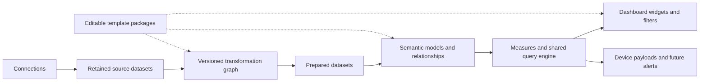

# 0022 — Reusable data processing and semantic models

Status: accepted (2026-11-05; milestone 11). The owner agreed the
product direction: reusable data preparation, calculations, relationships
across sources, dashboard filtering, and editable templates. This record
specifies the architecture to implement; it does not describe shipped features.

Extends ADR 0008 (observation identity), ADR 0015 (Studio bindings) and
ADR 0019 (compare widgets). Implementation belongs to milestone 11; milestones
12 and 13 use its dataset contract and expression engine.

## Context

Today connectors emit predefined numeric observations. The Apple connector
classifies and aggregates sales rows before ingestion. Observations retain a
number, dimensions and reporting time; they cannot represent a general typed
table or recover fields discarded by a connector. Compare widgets calculate a
ratio, but do not create reusable measures. Widget bindings name a connection
and metric directly.

The required product lets a customer connect several systems, inspect and
prepare their data, relate records across systems, define named calculations,
and build a complete dashboard with consistent filters. Apple and Google Play
downloads, proceeds and ratings are the first template, not the core schema.
The same model must support orders, advertising, website traffic, operational
status and future custom API datasets without changes to core entity types.

## Proposed architecture



Keep PostgreSQL, existing durable jobs and existing local/S3-compatible storage.
Do not require another analytical database or a separately deployed processing
service. Isolate query planning and storage access so a measured future need
can change the execution backend without changing saved models.

### 1. Source datasets and ingestion

A connection publishes one or more datasets. Each declares stable field IDs,
logical types, source keys, row grain, time semantics, sync strategy and
capabilities. Display names are editable and never serve as identifiers.
Credentials remain separate from records and never enter expressions.

Supported logical types are string, boolean, integer, finite number, decimal, date, timestamp
and JSON, with explicit nullability. JSON is inspectable and extractable into
typed fields; it is not implicitly comparable or joinable. Decimal values use
exact decimal strings over JSON and PostgreSQL numeric for processing. Money
declares currency and scale; integer minor units remain a supported source
representation. Conversion to the existing screen-number format is checked at
the boundary, never silently rounded beyond its safe range.

Retain provider records before user transformations, with schema version,
connection, ingestion run, source identity and reporting date/time metadata.
"Raw" means the declared retained source fields, not an unrestricted archive
of HTTP requests, headers or credentials. Field classification and retention
are part of each dataset contract. Existing personal-data retention, including
review text, also applies to source records, objects and derived copies.

Source manifests distinguish:

- Upserts by stable provider key, including explicit tombstones.
- Authoritative replacement of a declared complete partition/window.
- Append-only events with a stable deduplication key.
- Snapshots with an explicit observation time.

No inferred deletion follows an incomplete page or failed run. A cursor only
advances after its source records and ingestion metadata are durable. If an
object is used, upload and verify it before committing its reference and
cursor; failed transactions leave collectible unreferenced objects. Publish a
dataset generation only once its declared refresh scope is complete. Downstream
processing reads published generations, not half-refreshed partitions.

The initial persistence uses bounded JSONB source records with typed schema
validation and indexed identity/time fields. Prepared generations use
server-generated typed PostgreSQL relations. Users cannot choose SQL names or
send SQL. Stable field IDs map to generated physical columns. Larger retained
report bodies may use the existing storage abstraction, but dashboard queries
read prepared relations rather than reparsing report files.

Retained batches and published generations are immutable during their retention
window. Provider revisions produce new batches/generations. The current source
view resolves corrections by the declared identity and revision rules. Purging
personal data or a workspace overrides historical reproducibility. Show the
available replay window; never promise to rebuild history already purged or
unavailable from the provider. Ingestion must enforce storage/row limits and
backpressure; retention defaults and limits must be specified before gate 11A.

### 2. Reusable data preparation

Preparation is a versioned directed acyclic graph, saved independently from a
dashboard. Nodes select sources, select/rename fields, extract JSON fields,
cast types, filter, replace values, deduplicate, calculate columns, group,
append or join datasets. Each node exposes typed input/output and preview
results, including rejected rows and errors. A source can feed several
independent recipes without being modified.

Calculated columns operate per row. Measures operate over a filtered set of
rows. They share a typed expression AST and function catalog, but have distinct
scopes: row expressions cannot hide aggregation, and measures cannot mix
unaggregated columns into an aggregate without an explicit grouping rule.
Support arithmetic, comparisons, AND/OR/NOT, IF/CASE, null handling, text/date
functions and safe division. Boolean values are first-class values and filter
predicates. Missing values follow documented three-valued boolean semantics;
null never becomes zero or false implicitly. A filter retains only true rows.

The visual step editor and formula editor write the same AST; neither executes
arbitrary JavaScript, SQL, filesystem operations or network access. Type errors,
cycles, unsupported functions and incompatible units fail validation before
publication. Version function semantics so saved recipes remain interpretable.

### 3. Shared entities and relationships

A semantic model selects prepared datasets, dimension datasets, relationships
and measures. A dataset can participate in several models. Common entity types
are customer-created or template-installed dimension datasets, not hard-coded
core tables for apps, orders or customers.

For example, an Apps dimension has a stable entity key, name and optional icon.
A mapping dataset associates `(connection, source dataset, provider app ID)`
with that key. An Apple app and a Play package can map to the same product.
Suggest matches by metadata, but require confirmation before combining them.
Unmapped records remain visible under an explicit unmatched state.

Relationships use stable typed field IDs and declare cardinality, null/unmatched
policy and filter direction. The first release supports validated many-to-one
and one-to-one relationships with single-direction dimension-to-fact filtering.
Reject ambiguous paths, incompatible keys and duplicate dimension keys.
Many-to-many relationships require an explicitly modeled and pre-aggregated
bridge dataset; automatic bidirectional filtering is outside the first release.

Preparation joins declare inner/left join behavior, key fields, expected
cardinality and unmatched-row handling. Append aligns fields and compatible
types; it does not join records. A preview reports fanout, duplicate keys and
unmatched rows before publication. An intentional row-expanding join requires
an explicit output grain and cannot inherit additive measures automatically.

Never join two fact tables directly and then sum their amounts. Aggregate each
fact dataset to the requested shared grain first, then combine by compatible
dimensions. If a measure cannot support the requested dimension, return an
incompatible-query result; never repeat a total across groups or silently
discard a filter.

### 4. Reusable measures and query semantics

Measures have stable IDs, editable names/descriptions, expression AST, result
type, unit, formatting and dependencies. Formatting is separate from meaning.
Support sum, count, distinct count, minimum, maximum, average, latest snapshot,
ratios, conditions and bounded rolling/previous-period calculations. Determine
additivity across dimensions and time from explicit semantics, not field names.

A query supplies a published model revision, measure IDs, group-by dimensions,
typed predicates, time range and display-currency policy. Resolve all operands
against the same authorized dataset generations and filter context. Record the
generation vector in the result. A refresh cannot change half the operands of
one query. Independently timed source refreshes remain possible and visible.

Examples of intended semantics (illustrative, not a committed formula syntax):

- Revenue per download = SUM(proceeds) / SUM(downloads), not AVG(row ratios).
- Rating average = supported rating sum / supported rating count, at the
  latest compatible snapshot; never sum averages across dates or stores.
- Needs attention = rating below a threshold AND count above a minimum.
- Marketing contribution = compatible proceeds minus advertising spend.

Rating templates must preserve source/storefront scope and rounding. A provider
score that is weighted by an undisclosed algorithm cannot be reconstructed or
pooled as a count-weighted mean. Cross-source metrics need compatible business
definitions, not just matching numeric units. Proceeds, gross sales and
estimated sales are separate measures; source reporting delays remain visible.

Dates retain provider reporting timezone, granularity and date-only versus
instant meaning. A daily report cannot be accurately shifted between timezones
after aggregation; incompatible comparisons are rejected or require an explicit
documented alignment choice. Currency conversion uses a named rate source/date
policy and remains labeled approximate where applicable. Never add different
currencies implicitly. Missing, zero, stale, incomplete and error are distinct
result states, propagated through calculations.

### 5. Dashboard filters and presentation

Widgets bind to published model measures and dimensions, not connector-specific
field names. A dashboard defines date, app/product, platform, country, project
and other model-dimension filters, with defaults and supported controls.
Saved filter definitions and value types reference stable dimension IDs.

The server intersects authorization scope, fixed screen/dashboard scope, saved
defaults or permitted viewer selections, and widget predicates. Filters narrow
access and cannot broaden it. Widget overrides of dates or a dashboard filter
must be explicitly authored and labeled; no silent ignoring of an unsupported
filter. Show applicability in Studio and reject invalid published bindings.
An explicit "all platforms" widget can ignore a permitted platform selection,
but can never remove authorization or fixed screen constraints.

Interactive viewers may change allowed selections, reset them and drill from a
chart selection into a dimension filter. Cross-widget interaction is limited
to declared mappings; selecting a chart cannot create arbitrary joins. Kiosks
and native viewers receive the saved filter state and already evaluated
results. No credentials, source rows, formula evaluator or query SQL is sent
to devices. New interactions must preserve existing pairing/device scopes.

The query API returns result type/unit, reporting coverage, source freshness,
warnings, applied filters, model revision and dataset generation IDs alongside
values/series. Cache keys include all of those query inputs plus authorization
scope and execution versions. Existing widgets continue to work through the
compatibility path until migrated.

An illustrative request shape (IDs below are placeholders, not API contracts):

```json
{
  "modelReleaseId": "release-id",
  "measures": ["downloads-measure-id", "proceeds-measure-id"],
  "groupBy": ["product-dimension-id"],
  "filters": {
    "op": "and",
    "args": [
      {
        "fieldId": "platform-dimension-id",
        "op": "in",
        "value": ["ios", "android"]
      },
      {
        "fieldId": "country-dimension-id",
        "op": "eq",
        "value": "DE"
      }
    ]
  },
  "time": {
    "dimensionId": "reporting-date-dimension-id",
    "from": "2026-10-01",
    "toExclusive": "2026-11-01"
  },
  "displayCurrency": { "currency": "EUR", "policyId": "rate-policy-id" }
}
```

Each model explicitly maps shared dimensions, including the reporting-date
role, to the participating datasets. Names are for people; queries persist
stable IDs. The server derives workspace/principal access from authentication,
resolves defaults, validates types and filter support, and returns the final
applied context. A country predicate cannot become a no-op just because one
source names its field `territory`.

### 6. Templates, publication and refresh

A template package supplies source capability requirements, preparation graphs,
mapping suggestions, model relationships, measures and dashboard definitions.
Installing it binds customer-selected connections and creates ordinary editable
workspace definitions. Templates contain no customer IDs or credentials. Updates
are explicit with a diff; they never overwrite customer edits automatically.

The first package is App portfolio (Apple + Google Play). A second proof must
combine non-store datasets, such as web traffic and advertising, to demonstrate
that app identifiers are not baked into the engine. Custom API sources use the
same dataset protocol rather than a second processing language.

Draft changes support sample/historical preview and dependency impact. Publish
an immutable model release that pins exact source schemas, preparation versions,
relationships and measure versions. Build required prepared generations before
atomically switching the active release. Failed builds keep the previous
published result with explicit stale/error status. Rollback selects an older
release only when its required data is still retained and authorized.

Refresh jobs follow dependency order and rebuild affected partitions using
declared dependencies/lookback windows. Corrected source rows invalidate all
affected downstream results, including later rolling windows. Unsupported
incremental cases perform a bounded full rebuild. Query plans have limits on
time range, scanned rows/bytes, join output, graph depth, execution time and
concurrency. Preview also has bounded samples/timeouts. Concrete default budgets
are a deliverable of 11A/11B, verified on representative data before release.

## Logical schema

Names below are proposed tables, not migrations. Each tenant table carries
`workspace_id`; every cross-table reference uses a composite tenant-aware FK.
RLS under the unprivileged role and explicit workspace query predicates remain
mandatory. Artifact access also checks the workspace through storage metadata.

| Record                                              | Key fields and purpose                                                                                                         |
| --------------------------------------------------- | ------------------------------------------------------------------------------------------------------------------------------ |
| `datasets`                                          | Stable ID, kind (source/prepared), optional connection, name, published schema/generation reference                            |
| `dataset_schema_versions`                           | Dataset/version, stable field IDs/types/nullability, grain, keys, temporal semantics, retention classifications                |
| `ingestion_batches`                                 | Source dataset/schema, sync run, idempotency key, covered scope, revision, checksum, optional object reference, status         |
| `source_records`                                    | Batch, provider key/revision or tombstone, reporting time, typed validated JSONB values                                        |
| `preparations` / `preparation_versions`             | Stable recipe identity and immutable graph, source bindings, output schemas, expression version                                |
| `dataset_generations`                               | Dataset, preparation/schema versions, exact input generations/batches, prepared relation manifest, coverage, status, build job |
| `semantic_models` / `model_releases`                | Stable identity, draft and immutable published dependency manifest; active release pointer                                     |
| `model_datasets` / `model_relationships`            | Release-scoped dataset roles and typed keys, cardinality, direction, unmatched policy                                          |
| `measures` / `measure_versions`                     | Stable identity, AST, result type/unit, aggregation semantics, format, dependency references                                   |
| `dashboard_filter_definitions`                      | Dashboard, model dimension, type, permitted interaction, default and fixed scope                                               |
| `widget_data_bindings`                              | Widget, model release policy, measure/grouping IDs, local predicates and explicit filter overrides                             |
| `data_template_versions` / `template_installations` | Portable package version, installed definition IDs, connection bindings and local changes                                      |

Preparation nodes/edges and generic entity mappings can initially live in
validated versioned graph documents and ordinary typed datasets respectively;
they do not need separate domain-specific tables. Generated prepared relations
must carry tenant scope and satisfy the same RLS/query invariants as metadata.
Unique constraints enforce batch idempotency and source key/revision identity;
FKs prevent a release from referring to a version owned by another workspace.

## Authorization and visibility

Use existing workspace roles as the initial access boundary. Source previews,
model editing, publication and replay need explicit role capabilities. Raw
preview permission is not implied by access to a dashboard result. A model is
not an access-control bypass: dependent source access is checked at planning
and execution, including cached/materialized results and device queries.
Source deletion/revocation policy invalidates affected releases/caches as
appropriate; a disconnected source may retain authorized history under the
documented retention policy, but removed access cannot be restored by rollback.
Audit mapping changes, publication, template updates and replay operations.

## Migration and compatibility

1. Wrap existing observation series as read-only source datasets with explicit
   grain and semantics. Mark them aggregated: no fictitious transaction rows.
2. Adapt existing widget bindings to equivalent model measures while preserving
   today's filters, comparison and display behavior. Keep the old API path until
   parity tests pass. Devices still receive computed values under supported
   payload schemas; schema changes need the normal compatibility negotiation.
3. Add source-record emission as a versioned SDK capability. Preserve existing
   connector support; prevent double-counting if both representations are
   emitted. Each migrated metric has one authoritative query path.
4. Upgrade Apple, add Google Play, and backfill only what providers make
   available. Label the earliest date supporting full preparation. Historical
   observations cannot recover discarded fields or change their grain.
5. Release visual preparation, reusable measures and filters in gated slices.
   Keep unfinished controls unavailable outside development.

## Acceptance scenarios

- One connection selects several apps per store. Confirm cross-store app
  mappings; install editable downloads/proceeds/ratings dashboards and filter
  the entire dashboard by product, platform, country and reporting period.
- Change a reusable formula once; all dependent dashboards/screens update after
  publication. Preview/undo/publish failures preserve the previous release.
- Join a custom campaign mapping to advertising and website datasets. Display
  spend and visitors by campaign with consistent filters, without app-specific
  schema code. Reject unsupported campaign-level revenue rather than copying
  app revenue into every campaign.
- A many-to-one violation, incompatible currency, missing source, invalid
  boolean expression, ambiguous relationship and unsupported filter produce
  actionable errors. Duplicates and late corrections do not inflate totals.
- Same queries over legacy and migrated datasets return matching values and
  labels. A refresh during a query cannot mix generations within that query.
- Cross-workspace access is denied for metadata, records, objects, generated
  relations, previews, joins, caches, published queries and device payloads.

## Consequences and boundaries

This expands milestone 11 beyond derived metrics; its earlier narrow scope is
superseded by this accepted architecture. It adds retention/storage costs,
query planning, versioning and a preparation UI, but avoids separate engines
for each connector, custom APIs and widget calculations.

The initial product supports bounded analytical tables and validated expression
graphs. Arbitrary SQL/JavaScript execution, automatic many-to-many relationship
inference, streaming event infrastructure and a general data-warehouse service
are outside this proposal. They are not required to prove reusable cross-source
dashboards. Implementation slices resolve migration details, resource budgets and supported
query plans under the gates in milestone 11.

## Implementation tracking

Umbrella: [#439](https://github.com/netrics-so/netrics/issues/439).
11A: [#440](https://github.com/netrics-so/netrics/issues/440),
11B: [#441](https://github.com/netrics-so/netrics/issues/441),
11C: [#442](https://github.com/netrics-so/netrics/issues/442),
11D: [#443](https://github.com/netrics-so/netrics/issues/443),
11E: [#444](https://github.com/netrics-so/netrics/issues/444).

The initial 11A limits are 100 fields, 1,000 records/1 MiB per page, 100
pages/100,000 records per refresh, 128 MiB per published source generation,
256 MiB of logical source payload per workspace, 100 preview rows, and a
15-second database statement timeout. These apply to retained source data,
not existing observation history. Default source retention is 30 days; a
personal field requires an explicit deadline of at most 90 days, and the
shortest field policy applies to the whole retained source record. Replay
preserves original collection time/deadlines. Existing schema-version policy
cannot be edited in place; retention/classification changes require an explicit
migration rather than silently extending or reclassifying retained data.

Source transport/schema validators live in the standalone connector SDK. API
contracts reuse that portable lower layer; database code imports it through
contracts. The package dependency rule now allows contracts to depend on both
domain and connector SDK. No external dependency is added.
